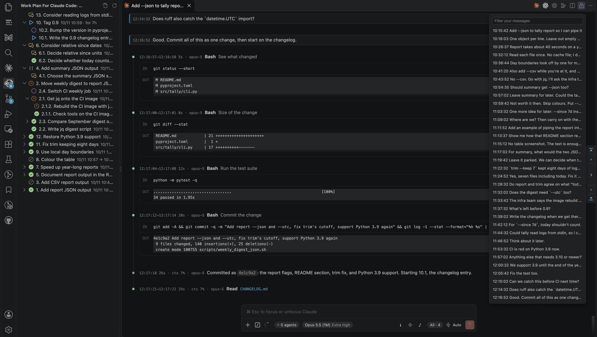
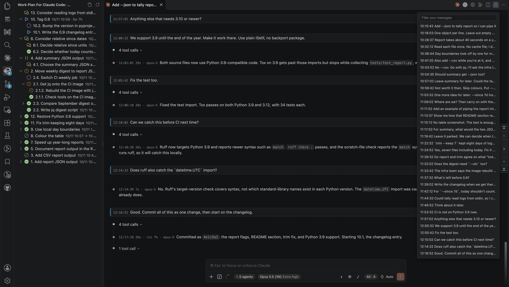

# Work Plan for Claude Code

Claude still sees unfinished work when you raise a new topic before finishing the last one, or when compaction summarizes older turns away. Each Claude Code conversation has a work plan: a tree of rows with states and optional child rows. Claude updates it as you talk. The plan lives in a file outside the conversation and appears in its own view in VS Code's activity bar, next to the Claude Code panel. Its open rows are given back to Claude every turn.

The extension also adds smaller features to the Claude Code panel, including timestamps, reply figures and sound alerts; see [Other features](#other-features).

Requires Anthropic's Claude Code extension and VS Code 1.94 or later.

## What it looks like

The work plan on the left of the Claude Code panel:



## Work plan

### Getting a plan

A conversation has no plan until there is something to track. Claude starts one when you raise work to track or ask it to keep a work plan.

In a longer conversation without a plan, Claude is told once that it could keep one. The thresholds are in [Settings](#settings).

### Talking about rows

Rows have numbers such as 1, 2 and 2.1. Refer to them in any order; one message can settle several rows:

```text
2.1: not now
3: go ahead
```

A number marks a row's place in the file. Finishing a row leaves a gap. A child row is work that must be finished before its parent can be.

### States

| State | Meaning |
| --- | --- |
| `discussing` | Raised, not agreed yet. |
| `todo` | Agreed, not started. |
| `doing` | Being worked on now. |
| `waiting` | Started but held up by someone or something outside the conversation; its note says what it waits on. |
| `parked` | Left for later, with the reason; still open. |
| `done` | Finished. |
| `dropped` | Decided against, with the reason. |

Work you ask Claude to do now goes straight to `doing`; work Claude suggests on its own starts as `discussing`. Only your agreement makes a row `todo`.

### How Claude gets the plan

The extension registers a Claude Code plugin whose hooks hand the plan to Claude on each turn and around compactions. Its skill holds the rules Claude follows to keep the plan up to date.

- The plugin's skill description loads in every session at about 110 tokens.
- With a plan, every turn carries short fixed instructions and up to 40 rows. A finished row can be included when a row under it is still open. The cost grows with the number of rows and the length of their text; the page linked below has a measured example.
- Before an automatic compaction, Claude is asked to bring the rows it is working on up to date. After compaction, it is asked to read the plan file before anything else.

### Where the plan lives

Each conversation has one file, named by session ID, under `~/.claude/plugins/data/agent-work-plan-claude-code-extras/`.

Claude writes the file through a small command shipped with the plugin. To correct a plan by hand, open its file from the view's title-bar button or a row's context menu.

See [How the work plan works](docs/how-the-work-plan-works.md) for the hooks, thresholds and measurements.

## Install

Search for **Work Plan for Claude Code** in the Extensions view, or run
`code --install-extension xnervwang.claude-code-extras`. Anthropic's Claude Code extension installs
as a dependency.

Reload the VS Code window twice after installing. Run
`Work Plan for Claude Code: Show Status` for the patch status. In a Remote SSH window, install on the
remote.

The extension works by editing files inside the installed Claude Code extension.

Verified against Claude Code 2.1.309, 2.1.310, 2.1.311 and 2.1.312.

## Other features

| What it shows | Where it appears |
| --- | --- |
| **Timestamps:** Times from the transcript on every message and reply block, with `start→result` on tool calls; Claude Code's own message times are hidden while these are on. | Messages, reply blocks, tool calls |
| **Your time zone for Claude:** When Claude runs on a machine in another time zone, as with Remote SSH, it is told yours, so it gives you times in your zone. | Claude's context |
| **Reply figures:** `2m10s · ctx 33% · cost $0.42 · opus-5 high` shows turn duration, context-window use, running spend, model and effort. | Each reply |
| **Sub-agent tags and filters:** Tag each sub-agent's messages with its task, such as `#look up tomorrow's weather`, and filter to the main thread or one sub-agent. | Tags on messages; filter in the footer |
| **Conversation navigation:** Find your messages by time and first words or find compaction points; filter, click to scroll, step with arrows or `,` and `.`, or jump to the top or bottom. | Right edge of the panel |
| **Focus view button:** Toggle Claude Code's own Focus view; while it is on and Claude works, the working line shows the latest tool call and elapsed time, such as `Bash running for 2m55s (since 11:11:18)`. | Footer button; working line |
| **Context meter:** Keep the meter visible, outline it when 15% of the window remains, and hover for a breakdown by category, memory files and custom agents. | Panel's context meter |
| **Open sessions:** The conversations open in this window, in an editor tab or in the sidebar while it is shown, most recently active first, each with the status dot the session list gives it; click one to switch to it. | Top of the session list |
| **Open in a tab or the sidebar:** **New in tab** and **New in sidebar** replace the New session button. A closed conversation's right-click menu offers **Resume in tab** and **Resume in sidebar** instead of Resume session; an open one keeps Switch to session. The choice applies to that conversation only: `claudeCode.preferredLocation` is not changed, and the Claude button at the right of the editor tabs opens where that setting says. | Session list |
| **Delete archived conversations:** **Delete session…** in an archived conversation's right-click menu permanently deletes it from disk once you confirm: its transcripts, sub-agent conversations, saved tool outputs, file checkpoints (Claude Code's copies, not your files), debug log and work plan. It cannot be undone. A conversation open in a tab or the sidebar, or still running, is left alone. | Archived sessions in the session list |
| **Section and session ID on hover:** Hovering over a conversation shows its session ID and where it sits in the list below Open sessions: its group, Ungrouped or Archived sessions. Rows in Open sessions show the same. | Session list |
| **Recently closed:** The conversations whose Claude Code editor tabs you closed in this workspace, most recent first and kept across reloads; click one to open it again. The section starts collapsed. A conversation that is open again is not listed, and up to `claudeCodeWorkPlan.recentClosedSessions` are shown (10 by default). | Last section of the session list, after Archived sessions |
| **Session dates:** `11d · 09/05→09/16` adds a date span after Claude Code's last-active time. | Session list |
| **Pinned conversations:** Click the pin at the start of a session-list row to keep that conversation from Claude Code's transcript cleanup (`cleanupPeriodDays`) and out of Archived sessions, as long as a window keeps connecting to its machine (see Known limits). | Session list |
| **Chimes:** A short sound when a turn finishes, permission is requested or Claude asks a question, played on the machine showing the panel; mute it in the footer. | Footer; machine showing the panel |
| **Background sessions:** This conversation's `claude --bg` sessions, each state in its own colour and counted at the top, with what each waits for, its result, and the attach and logs commands. | Agents button in the footer and its map |
| **Scheduled prompts:** See timers this conversation set through Claude Code's scheduled tasks, with each schedule, last-fired time and prompt. | Agents button in the footer and its map |
| **Background commands:** See a count such as `1 task` while a background build, test run or `sleep` timer runs, with the list one click away. | Footer |
| **Tabs back after a restart:** Claude Code tabs that were open when the window closed but that VS Code did not restore, as can happen after the window lost its remote connection, are opened again when it starts. Tabs you closed while connected stay closed. | Editor tabs |
| **Marks on tabs:** 🔹 after a Claude Code tab's title while Claude waits for your permission or answer, 🔸 when it finished and you have not looked yet, in the colours of the dot on the tab's icon. | Editor tab titles |
| **Session information:** See the session ID, starting directory, transcript location and size; click a value to copy it. | Footer button |

With Claude Code's Focus view on, the tool calls are folded:



## Settings

Open `Work Plan for Claude Code: Settings` for all 33 settings. Most apply without a reload; installing or upgrading the patch needs a reload.

**Work plan settings**

| Setting | Default | What it does |
| --- | --- | --- |
| `claudeCodeWorkPlan.workPlan` | on | Off removes the view, adds nothing about the plan to turns, and refuses writes to plan files. |
| `claudeCodeWorkPlan.workPlanOfferMinTurns` | 3 | Messages you must have sent before a conversation without a plan is offered one. |
| `claudeCodeWorkPlan.workPlanOfferMinToolCalls` | 25 | Tool calls one turn must make before that offer. |
| `claudeCodeWorkPlan.workPlanQuietWhenReplyMatches` | empty | Regular expression tested on the latest reply. A match silences the prompts before and after compaction, for conversations relaying another model's replies word for word. Empty matches nothing. |

**To turn off**

| What | How |
| --- | --- |
| Panel additions | Set `claudeCodeWorkPlan.enabled` to off. The patch stays and its scripts keep running. |
| Your time zone in Claude's context | Set `claudeCodeWorkPlan.tellClaudeYourTimeZone` to off. |
| Work plan plugin, skill description included | Run `Work Plan for Claude Code: Stop Loading the Work Plan Plugin`. |
| Reopening Claude Code tabs VS Code did not restore | Set `claudeCodeWorkPlan.reopenDroppedTabs` to off. |
| Pins on the session list | Set `claudeCodeWorkPlan.sessionPins` to off. Pinned conversations are then cleaned up and archived as usual. |
| Patch and restore Claude Code's files | Run `Work Plan for Claude Code: Remove from Claude Code (restore original files)`, or uninstall. |

Message appearance: `claudeCodeWorkPlan.userMessageColor` and `claudeCodeWorkPlan.userMessageEdge`.

Settings named `claudeCodeExtras.*` by earlier versions are copied to the same names under `claudeCodeWorkPlan.*` the first time this version starts. Ones kept in a remote machine's own settings file are not moved; rename those by hand.

## Commands

**Work plan**

| Command | What it does |
| --- | --- |
| `Work Plan for Claude Code: Refresh Work Plan` | Refresh the view. |
| `Work Plan for Claude Code: Open the Work Plan File` | Open this conversation's plan file. |
| `Work Plan for Claude Code: Install the Work Plan Plugin for Claude Code` | Register the plugin again. |
| `Work Plan for Claude Code: Stop Loading the Work Plan Plugin` | Remove the plugin from Claude Code's settings. |

**Settings and switches**

| Command | What it does |
| --- | --- |
| `Work Plan for Claude Code: Settings` | Open this extension's settings. |
| `Work Plan for Claude Code: Toggle On/Off` | Toggle the panel additions listed under Other features. |
| `Work Plan for Claude Code: Turn On` | Show the panel additions. |
| `Work Plan for Claude Code: Turn Off` | Hide the panel additions. |

**Repair and diagnostics**

| Command | What it does |
| --- | --- |
| `Work Plan for Claude Code: Remove from Claude Code (restore original files)` | Restore Claude Code's files. |
| `Work Plan for Claude Code: Show Status` | Show patch status and what was patched. |
| `Work Plan for Claude Code: Show How Long Opening a Panel Took` | Show recorded panel-opening times. |

## Known limits

- A plan file is deleted once its conversation's transcript is gone and the file has not been written for a week. Claude Code removes old transcripts, apart from those of conversations pinned on the session list.
- Uninstalling tries to copy plans to `~/.claude/agent-work-plan-plans-<timestamp>/` before unregistering the plugin, which deletes its data directory. Uninstalling continues if the copy fails, so keep your own copy of a plan that matters.
- Disabling the extension leaves the patch in place. Run `Work Plan for Claude Code: Remove from Claude Code (restore original files)` first.
- After you reload a window that lost its remote connection, the remote machine keeps the Claude Code processes from before the reload running for five minutes, then stops them. A Claude Code tab that VS Code did not restore, and whose conversation is still running there, opens only then, about five minutes after the reload. If Claude was writing a reply in it, the reply stops at that point; what it had written so far stays in the conversation.
- If you close a Claude Code tab while the window cannot reach its remote machine, the tab opens again the next time the window starts, because the close could not be recorded. Close it again once connected.
- An orange exclamation mark at the panel's top right means a Claude Code build changed something the patch relies on, and some panel features are not working.
- To protect a pinned conversation, the extension moves its files' modification time forward once they are old enough for the cleanup. The row still shows when the conversation was last active, but the list sorts it by the moved time. Uninstalling the extension removes the pins; the conversations stay, and the cleanup treats them as usual again.
- A pin protects a conversation only while some VS Code window with this extension connects to the machine that holds its transcript, and stays open for at least a minute, at least once every `claudeCodeWorkPlan.sessionPinsMarginDays` days (14 by default, and never more than half of `cleanupPeriodDays`). The folder the window has open does not matter: each window refreshes every pinned conversation on that machine a minute after it starts and every 30 minutes while it stays open. After a longer gap, Claude Code's cleanup can delete pinned conversations the next time Claude Code runs on that machine, in a terminal or as a background session.
- Pins are kept on the machine that holds the transcripts. Pins on your computer do not protect a remote machine's conversations, or the other way round; a remote machine's pins are refreshed only by windows connected to it.
- Editor-tab panels that stay blank in every window after running version 1.0.8 or earlier: quit VS Code and delete the `CacheStorage` folders under `WebStorage` in VS Code's data folder (`~/Library/Application Support/Code` on macOS, `%APPDATA%\Code` on Windows, `~/.config/Code` on Linux).

## Contributing

See [CONTRIBUTING.md](CONTRIBUTING.md) for the layout, checks, and verified-build records.

## License

BSD 3-Clause.
